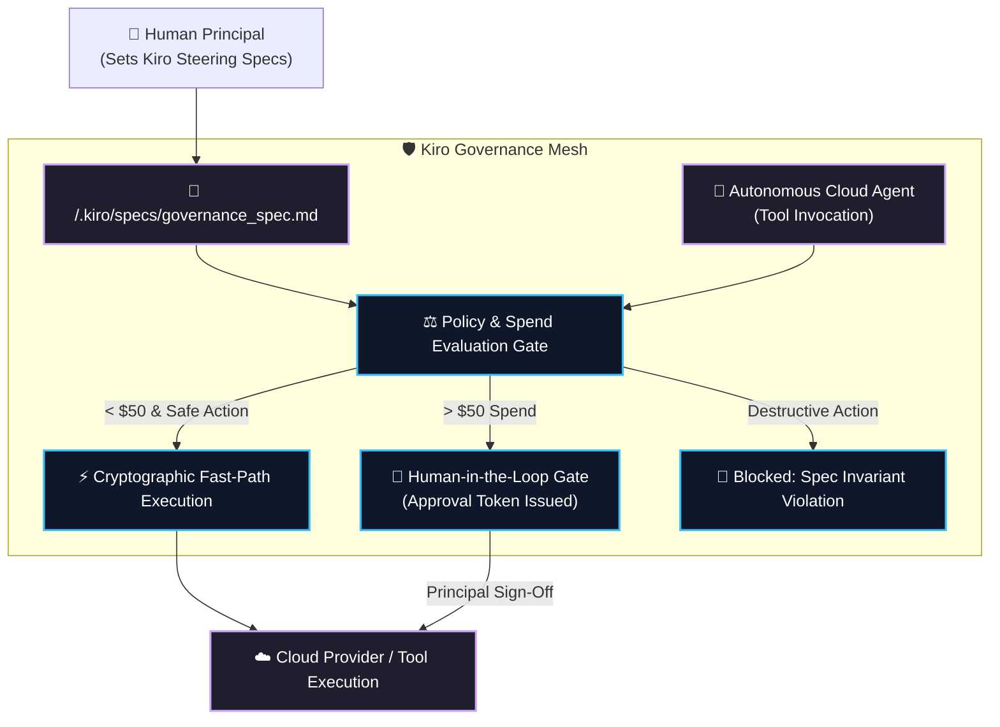

# 🎃 Kiro AutoGovernance Mesh — Kiroween 2026

[](https://www.typescriptlang.org)
[](https://opensource.org/licenses/Apache-2.0)
[](https://devpost.com)
[](./.kiro)
[](./test)

> **Built for [Kiroween 2026 (Devpost)](https://devpost.com)**  
> *Timeline: October 30 – December 4, 2026 • Prize Pool: $100,000*

Kiro AutoGovernance Mesh is a specification-driven execution harness for autonomous cloud and enterprise agents. Powered by Kiro steering specs (`/.kiro/specs`), it enforces deterministic spending caps, prevents unvetted destructive actions, and gates anomalous operations behind cryptographic Human-in-the-Loop (HITL) approval tokens.

---

## 🏛️ System Architecture



---

## 🚀 Quickstart & Verification

```bash
# 1. Run automated verification suite
npm test

# 2. Build production distribution
npm run build
```
